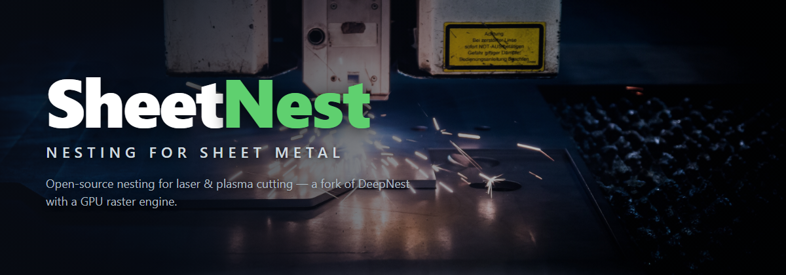

  

**SheetNest**: true-shape nesting software for sheet metal laser and plasma cutting.

**Download:** https://sheetnest.io

This repository holds the open-source code of SheetNest up to version 1.1.14, under the MIT License (see
[LICENSE](LICENSE) and [THIRD_PARTY_NOTICES.md](THIRD_PARTY_NOTICES.md)). The current SheetNest is downloaded from
[sheetnest.io](https://sheetnest.io) under the SheetNest License Agreement.

- fits the most parts on every sheet, packed by their real outline
- imports DXF drawings, and 3D STEP / IGES sheet-metal parts unfolded offline
- common-line cutting between compatible parts
- exports cut-ready DXF and a one-page PDF report per layout
- English, Spanish, German, Brazilian Portuguese, Simplified Chinese and Hindi
